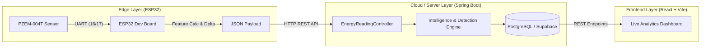

# Smart-Edge

An end-to-end IoT and edge intelligence platform for real-time electrical energy monitoring, appliance load event classification, anomaly detection, and energy forecasting.

Smart-Edge combines ESP32-based hardware telemetry with a high-performance Spring Boot backend and an interactive React dashboard to deliver granular insights into electrical consumption and grid health.

---

## Architecture Overview



---

## Key Features

- **High-Precision Telemetry**: Measures AC Voltage, Current, Active Power, Cumulative Energy, Frequency, and Power Factor in real time.
- **Edge Analytics**: Computes electrical deltas on-device and benchmarks serialization and transmission latency.
- **Non-Intrusive Load Monitoring (NILM)**: Identifies and classifies device power transitions and load events (ON/OFF switching).
- **Intelligent Anomaly Detection**: Tracks normalized deviations against running baselines to flag overvoltage, surges, unusual loads, and power quality degradation.
- **Energy Forecasting & Aggregations**: Generates daily statistics and predictive consumption models based on historical consumption trends.
- **Interactive Live Dashboard**: Modern React interface displaying real-time gauges, time-series charts, health status, and anomaly logs with stale data protection.

---

## Repository Structure

```
Smart-Edge/
├── smartedge-firmware/     # ESP32 firmware (PlatformIO / C++)
│   ├── include/            # Hardware pinouts, API configs, secrets
│   ├── src/                # Sensor reading, JSON serialization, WiFi client
│   └── platformio.ini      # PlatformIO configuration and dependencies
│
├── smartedge-backend/      # Core API and Analytics Engine (Spring Boot / Java 21)
│   ├── src/main/java/      # REST controllers, entities, services, intelligence
│   ├── src/main/resources/ # Database configs (PostgreSQL) and JPA properties
│   └── pom.xml             # Maven dependencies
│
└── smartedge-dashboard/    # Web UI (React 19, Vite, Recharts)
    ├── src/                # Dashboard views, live chart components, styles
    ├── public/             # Icons and static web assets
    └── package.json        # Frontend dependencies
```

---

## Subsystem Details

### 1. Firmware (`smartedge-firmware`)
- **Platform**: PlatformIO on `esp32dev` framework (Arduino)
- **Sensor**: PZEM-004T v3.0 over HardwareSerial (`RX: GPIO 16`, `TX: GPIO 17`)
- **Network**: WiFiManager / HTTPClient posting JSON payloads to backend `/api/readings`
- **Key Files**:
  - `include/config.h`: Hardware pinouts and sampling periods
  - `include/secrets.h`: WiFi and network configuration
  - `src/main.cpp`: Main sampling loop, delta extraction, and HTTP dispatch

### 2. Backend (`smartedge-backend`)
- **Framework**: Spring Boot 4 with Java 21, Spring Data JPA, and PostgreSQL
- **Key Modules**:
  - `EnergyReadingController`: Ingestion endpoint for edge telemetry and historical query endpoints
  - `IntelligenceController`: Normalized deviation analysis and load classification triggers
  - `AnomalyEventService`: Anomaly classification, baseline comparison, and severity scoring
  - `EnergyForecastService`: Historical consumption estimation and projection

#### Core REST Endpoints
| Method | Endpoint | Description |
|---|---|---|
| `GET` | `/api/health` | Service health status |
| `POST` | `/api/readings` | Ingest real-time readings from edge device |
| `GET` | `/api/readings/latest` | Retrieve latest telemetry record |
| `GET` | `/api/readings/recent` | Fetch historical stream for charting |
| `GET` | `/api/readings/stats/today` | Fetch daily aggregated statistics |
| `GET` | `/api/readings/intelligence` | Run real-time deviation and anomaly evaluation |
| `GET` | `/api/readings/forecast` | Retrieve consumption forecast |

### 3. Dashboard (`smartedge-dashboard`)
- **Stack**: React 19, Vite, Recharts, Modern CSS
- **Features**:
  - Real-time parameter streaming (Voltage, Current, Power, Power Factor, Frequency)
  - Interactive multi-parameter time-series charts
  - Anomaly history cards with severity indicators
  - Stale data detection if edge telemetry drops

---

## Getting Started

### Prerequisites
- **Firmware**: [PlatformIO](https://platformio.org/) installed in VS Code or CLI
- **Backend**: [JDK 21](https://adoptium.net/) and Maven 3.9+
- **Frontend**: [Node.js](https://nodejs.org/) (v18+) and npm

---

### Step 1: Run Backend

```bash
cd smartedge-backend

# Configure database credentials in src/main/resources/application.properties

# Run application
./mvnw spring-boot:run
```
The backend starts on `http://localhost:8080`.

---

### Step 2: Run Dashboard

```bash
cd smartedge-dashboard

# Install dependencies
npm install

# Start Vite dev server
npm run dev
```
Open `http://localhost:5173` in your browser.

---

### Step 3: Flash Firmware

1. Open `smartedge-firmware` in VS Code with PlatformIO.
2. In `smartedge-firmware/include/secrets.h`, update your WiFi SSID, password, and the backend IP:
   ```cpp
   #define WIFI_SSID "Your_SSID"
   #define WIFI_PASSWORD "Your_Password"
   ```
3. Connect your ESP32 board and upload:
   ```bash
   pio run --target upload
   ```

---

## License

This project is licensed under the MIT License - see the LICENSE file for details.
